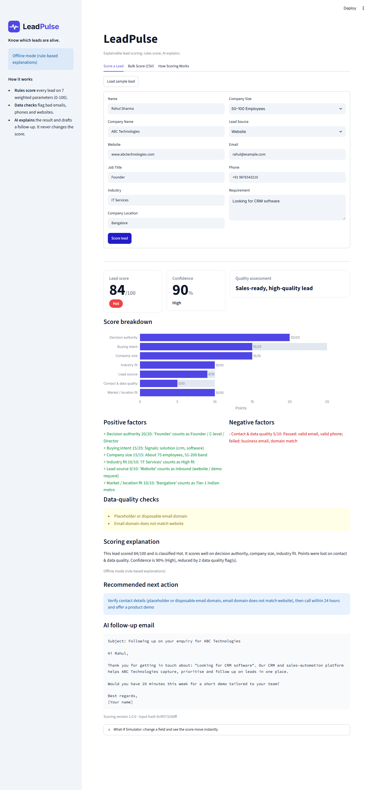
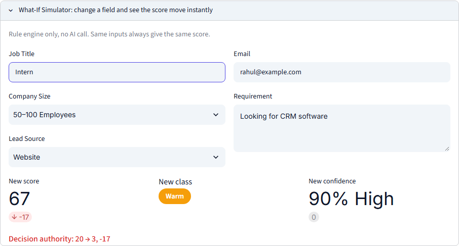
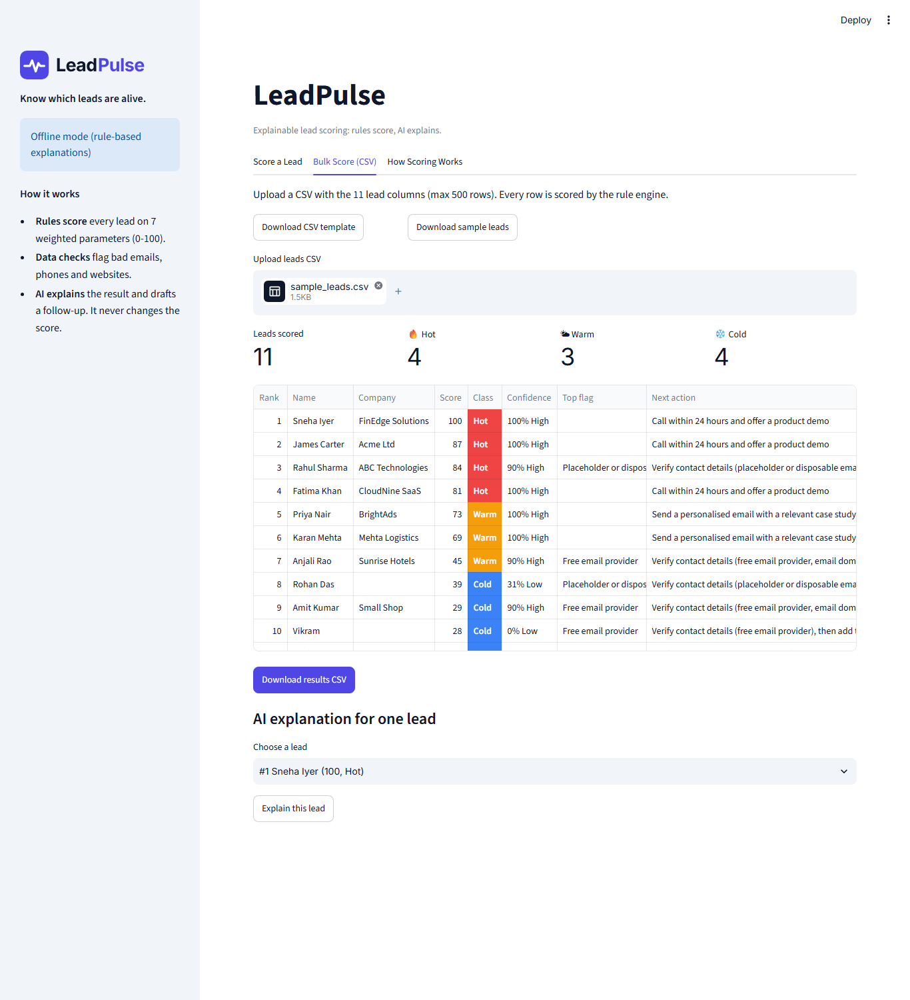
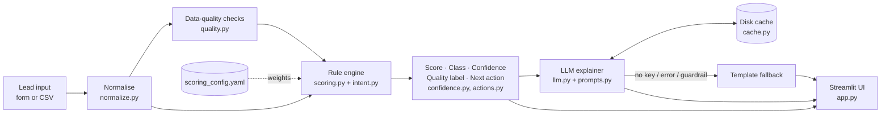

<p align="center">
  <picture>
    <source media="(prefers-color-scheme: dark)" srcset="assets/logo-dark.svg">
    
  </picture>
</p>
<p align="center"><b>Know which leads are alive.</b><br>AI-powered, explainable lead scoring</p>

<p align="center">
  <a href="#">Live demo (coming soon)</a> ·
  <a href="docs/METHODOLOGY.md">Scoring methodology</a> ·
  <a href="docs/TEST_CASES.md">Test cases</a>
</p>

LeadPulse scores sales leads from 0 to 100 with a transparent, weighted rule engine, then uses an LLM to explain the result and draft a follow-up email. Sales teams see **which leads to call first and exactly why**.



## The problem and the approach

Sales teams waste time on leads that were never going to buy, while hot leads go cold in the inbox. Asking an LLM to "rate this lead" gives a number that changes between runs and cannot be audited.

LeadPulse splits the job: **rules score, AI explains.** Seven weighted parameters (all in one YAML file) produce a deterministic score, class and confidence. The LLM receives that finished result and only writes the explanation and the email. It is never allowed to change the score, and a guardrail rejects any answer that tries.

## Features

**For every lead (all 7 required outputs)**
1. Lead score (0-100)
2. Classification: 🔥 Hot / 🌤 Warm / ❄️ Cold
3. Lead quality assessment
4. Positive and negative scoring factors
5. Scoring explanation
6. Confidence level (% and High / Medium / Low)
7. Recommended next action

**Extras**
- **What-If Simulator**: change Job Title, Company Size, Lead Source, Requirement or Email and see the new score, class and per-factor change instantly ("Decision authority: 20 → 3, -17"). Rule engine only, no AI call.
- **Data-quality checks**: invalid email, free email provider, placeholder / disposable domain, email-website domain mismatch, invalid phone (`phonenumbers`, India default), invalid website. Flags feed into scoring, confidence and the next action.
- **Bulk CSV scoring**: template download, upload up to 500 rows, ranked Hot → Cold table, bad rows skipped and reported, results CSV download, optional AI explanation per row.
- **AI follow-up email**: a short personalised first-contact email (subject + body), copyable.
- **Works offline**: with no API key, or if the LLM fails, everything still works; explanation and email come from clean templates.

| What-If Simulator | Bulk scoring |
|---|---|
|  |  |

## How scoring works

| Parameter | Field | Max |
|---|---|---|
| Buying intent | Requirement | 25 |
| Decision authority | Job Title | 20 |
| Company size | Company Size | 15 |
| Industry fit | Industry | 10 |
| Lead source | Lead Source | 10 |
| Contact & data quality | Email, Phone, Website | 10 |
| Market / location fit | Company Location | 10 |
| **Total** | | **100** |

- **Classes:** Hot ≥ 75 · Warm 45-74 · Cold < 45
- **Missing data:** a blank field gets a neutral 30% of its points, shows as a negative factor and lowers confidence.
- **Confidence:** starts at 100; -20 per missing critical field (Job Title, Requirement, Company Size, or both Email and Phone), -8 per other missing field, -5 per unrecognised value, -5 per data-quality flag. High ≥ 80, Medium 50-79, Low < 50.
- **Sample lead** (Founder, IT Services, Bangalore, 50–100 employees, "Looking for CRM software", rahul@example.com): **84 → Hot, 90% High confidence**, with the placeholder email and domain mismatch caught.

Full rules, keyword lists, reasoning behind each weight and a worked example: [docs/METHODOLOGY.md](docs/METHODOLOGY.md).

## Architecture



The dependency map was checked against the code with [graphify](https://github.com/safishamsi/graphify) (AST graph of `app.py` and `leadpulse/`): `scoring` is the hub that pulls in normalisation, quality, intent, confidence and actions, every rule module reads its numbers only from `config_loader`, and `llm` depends on the score result but nothing in the scoring path depends on `llm`.

## Tech stack

| Tool | Why |
|---|---|
| Python 3.12 + **uv** | Fast, reproducible installs; everything lives in the project's own `.venv` |
| **Streamlit** | A clean, interactive UI in pure Python, free hosting on Streamlit Community Cloud |
| **Pydantic** | Typed models for leads and results; strict validation of the LLM's JSON |
| **PyYAML** | Weights and keywords in one human-editable config file |
| **phonenumbers** | Google's phone validation library, far more reliable than a regex |
| **Plotly** | One clear points-vs-max bar chart |
| **pandas** | Bulk CSV results table and export |
| **google-genai / groq** | Gemini (default) or Groq for explanations, switchable in `.env` |
| **pytest** | 75 tests, no real API calls |

## Setup

**1. Install uv** (once per machine)

```bash
# macOS / Linux
curl -LsSf https://astral.sh/uv/install.sh | sh
```
```powershell
# Windows (PowerShell)
powershell -ExecutionPolicy ByPass -c "irm https://astral.sh/uv/install.ps1 | iex"
```

**2. Install and run**

```bash
git clone https://github.com/<your-username>/leadpulse.git
cd leadpulse
uv sync                      # creates .venv with Python 3.12 and all dependencies
cp .env.example .env         # Windows: copy .env.example .env
# optional: add GEMINI_API_KEY (or set LLM_PROVIDER=groq and GROQ_API_KEY) in .env
uv run streamlit run app.py
```

Without a key the app runs in **offline mode** with rule-based explanations.

**3. Run the tests**

```bash
uv run pytest
```

### Deploy to Streamlit Community Cloud

1. Push the repo to GitHub (public).
2. Go to [share.streamlit.io](https://share.streamlit.io), click **Create app**, pick the repo, branch `main`, main file `app.py`. Streamlit Cloud installs from `requirements.txt`.
3. Under **Advanced settings → Secrets**, add:
   ```toml
   LLM_PROVIDER = "gemini"
   GEMINI_API_KEY = "your-key"
   ```
4. Deploy, then put the app URL in the "Live demo" link at the top of this README.

## Sample test cases

Six documented leads (sample, strong Warm, Cold, missing data, junk, international) with input → score → class → confidence → reasons: [docs/TEST_CASES.md](docs/TEST_CASES.md). The same leads are asserted in `tests/`.

## Design decisions and trade-offs

- **Rules, not ML (for now).** There is no labelled conversion history to train on. A weighted rule set is transparent, explainable line by line, and easy for a sales manager to tune. ML becomes the right tool once outcome data exists (see below).
- **The LLM explains, it never scores.** LLM scores drift between runs and can't be audited. Here the LLM sees the finished result, must return strict JSON, and a guardrail throws away any answer that states a different score or class.
- **Temperature 0 + disk cache.** The same lead gets the same explanation every time, with no repeat API calls or cost.
- **Neutral points for missing data.** A blank field gets 30% of its weight: not rewarded, not punished to zero. The uncertainty is shown in the confidence score instead, so "low score" and "unknown" are never confused.
- **Confidence is separate from score.** A lead can be Hot but uncertain ("High potential, verify details first"). Sales reps see both.
- **Offline first.** No key, a timeout or a bad response never breaks the app; templates take over.

## Future improvements

- Learn the weights from historical won/lost deals (logistic regression first for interpretability, then gradient boosting), keeping the rule engine as a fallback.
- CRM integration (HubSpot, Zoho, Salesforce) to pull new leads and push scores back automatically.
- Enrichment APIs (company size, industry, funding) to fill missing fields and raise confidence.
- Score history and decay, so leads that go quiet cool down over time.

## Project structure

```
leadpulse/
├── app.py                      Streamlit UI (3 tabs + What-If)
├── leadpulse/
│   ├── config/scoring_config.yaml   all weights, keywords, thresholds
│   ├── config_loader.py        loads the YAML, checks weights total 100
│   ├── models.py               Pydantic: LeadInput, FactorResult, ScoreResult, LLMInsights
│   ├── normalize.py            cleaning, size parsing, domains, input hash
│   ├── quality.py              data-quality checks
│   ├── intent.py               requirement-text intent signals
│   ├── scoring.py              weighted rule engine (pure, deterministic)
│   ├── confidence.py           confidence % and label
│   ├── actions.py              quality label + next action
│   ├── llm.py                  Gemini / Groq client, JSON validation, guardrail, fallback
│   ├── prompts.py              system prompt + PROMPT_VERSION
│   ├── cache.py                on-disk LLM cache
│   └── bulk.py                 CSV validation + batch scoring
├── data/                       lead_template.csv, sample_leads.csv
├── tests/                      75 pytest tests (cases.py holds the sample leads)
├── docs/                       METHODOLOGY.md, TEST_CASES.md, DEMO_SCRIPT.md, screenshots/
├── assets/                     brand kit: logos, icon, style.css
├── .streamlit/config.toml      brand theme
├── pyproject.toml  uv.lock  requirements.txt  .env.example
```
